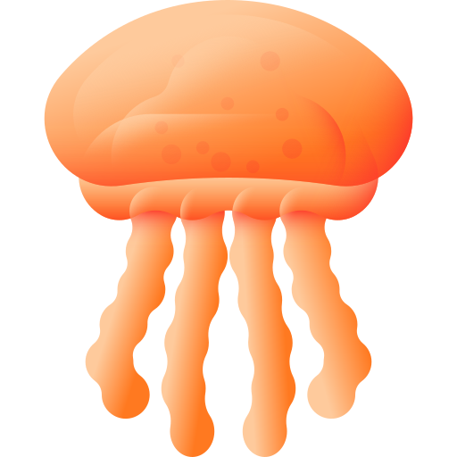

<div align="center">



# Jellyfish

### A Turkish-first cybersecurity model and agent runtime

[](https://github.com/erkanrzgc/jellyfish/actions/workflows/ci.yml)


</div>

Jellyfish (formerly Octópus) pairs a local language model with an inspectable agent runtime for cybersecurity and Linux/server tasks. The model produces structured tool calls; the runtime parses them, checks policy, executes allowed calls, and returns results to the model.

The product and training examples prioritize Turkish. Repository documentation is in English. This is a research prototype for authorized testing, labs, and defensive work.

## Current status

**Default model (since 2026-11-22): stock Gemma 4 E4B (`gemma4:e4b`) with native tool calling.** On 212 held-out cases it passed 177 vs 137 for the fine-tuned `octopus-v10`, refused unauthorized targeting as reliably, and fits 8 GB VRAM. It is weaker at investigating open-ended server incidents on its own; `run_tool_loop(evidence_push=True)` is an opt-in harness fix with a measured trade-off. See the [bake-off report](eval/reports/gemma4_e4b_bakeoff_2026-11-22.md).

Runtime defaults live in [`agent/config.py`](agent/config.py):

| Setting | Default |
|---|---|
| Ollama model | `gemma4:e4b` (native tools via `agent/backends/native_chat.py`) |
| Legacy model | `octopus-v10` (raw-prompt path, `--model octopus-v10`) |
| Legacy chat template | `models/jellyfish-v8-tokenizer` |
| Legacy import recipe | `models/Modelfile.v10` |

```powershell
ollama pull gemma4:e4b
uv run python -m agent.chat --ask "Kimsin sen?"
uv run python -m agent.cli --gguf
```

The legacy v1.0 path renders the v0.8 training template itself and calls Ollama in raw mode; v1.1 and v1.2 remain unpromoted experiments ([report](eval/reports/v1.2_gapfill_retrain_2026-09-15.md)). Artifact names such as `octopus-v10` and the `octopus-lab` Docker network keep their original names.

For development continuity across Codex and Claude, start with [`AGENTS.md`](AGENTS.md) and [`PROJECT_HANDOFF.md`](PROJECT_HANDOFF.md).

The first reliability increment hardens parsing, scope checks, execution accounting, and per-call approval without changing model weights. The [approved roadmap](docs/superpowers/plans/2026-10-23-cybersecurity-reliability.md) tracks the remaining work. The first [60 development cases](eval/suites/README.md) are source-backed drafts awaiting human and lab review, not a locked acceptance set.

## Quick start: offline runtime checks

Run from the repository root with Python 3.10+ and [uv](https://docs.astral.sh/uv/):

```powershell
uv sync --group dev
uv run python -m agent.smoke
uv run pytest -q
```

The smoke runner uses a scripted model, simulated security tools, and real temporary files. It requires no model downloads, GPU, Ollama, or Docker. Expected output:

```text
[PASS] mock-scan: scripted call -> policy -> simulated port output
[PASS] scope-denial: out-of-scope target rejected; executor not called
[PASS] workspace-files: real file write/read; path escape rejected
3/3 offline checks passed (no live model or security tools).
```

A failed check returns a nonzero exit code. Temporary files and audit logs are cleaned up after the run. These checks verify runtime plumbing and selected policy behavior; model quality and real-tool integration require separate validation.

To inspect the existing interactive-style transcripts:

```powershell
uv run python -m agent.cli
uv run python -m agent.cli --assistant
```

See the [demo guide](docs/DEMO_GUIDE.md) for prerequisites, expected behavior, and live lab commands.

## Run the evaluated model locally

Prepare the existing v1.0 Q4 GGUF and the evaluated tokenizer files as described in [`models/README.md`](models/README.md). These large artifacts are excluded from Git; cloning the repository does not install them.

With Ollama running and the artifacts present:

```powershell
ollama create octopus-v10 -f models/Modelfile.v10
uv run python -m agent.cli --gguf
```

This runs the real model with **mock security-tool output**. It does not scan a network. To choose another compatible model/template pair (already imported into Ollama; see [models/README.md](models/README.md)):

```powershell
uv run python -m agent.cli --gguf --model octopus-v9 --tokenizer-dir models/jellyfish-v8-tokenizer
```

The normal CLI is a single lab-scan demo, not a general chat interface. `--target` selects the demo target and `--scope` supplies the allowlist. Real execution uses `--real` or `--docker`; follow the demo guide before selecting those modes.

## Local conversation and auditable evaluation

The separate conversation entry point supports advisory answers and approved tool work:

```powershell
uv run python -m agent.chat --mode advise --profile octopus-v10
uv run python -m agent.chat --mode assist --executor mock --scope 10.10.10.0/24 --session lab/logs/chat.json
```

Advisory mode executes no tools. In assist mode, mock security results are labelled as simulated; real operations display their parameters and command and require an explicit terminal response. Approval is single-use, expires after five minutes, and is bound to the exact call, command, and execution context. Session files preserve conversation history without approval tokens. Denial, backend failure, and step limits leave the task unfinished.

The model-only baseline runner records raw responses, every emitted call, settings, timings, errors, truncation, and artifact hashes without executing security tools:

```powershell
uv run python -m eval.reliability_eval --profile octopus-v10 --suite eval/suites/reliability-dev-v1.json --out eval/reports/my-v10-dev60.json --host http://127.0.0.1:11434
```

Use a new report path for each run. Automatic checks cover output structure and selected tool/parameter expectations; semantic scores remain pending human review. The alternate `qwen3-4b-instruct-2507` profile has its own template configuration but its artifacts have not been provisioned or evaluated. An installed `qwen3:4b` alias is not evidence of that exact model.

## Architecture and execution coverage

```text
Turkish security SFT data -> bf16 LoRA -> model / GGUF
                                           |
                                    structured arac call
                                           |
parser -> tool registry -> policy -> executor -> result -> model
               |                       |
             audit               mock / Kali WSL / Docker
```

- **Catalog:** 117 security tools, 10 assistant tools, and 3 runtime extensions are described in the catalog. Catalog membership describes available names and parameters; it does not certify a working CLI adapter for every tool.
- **Mock executor:** simulated domain-specific output for demos and unit tests.
- **Kali WSL executor:** offers only validated nmap calls for approval, using argv with `shell=False` and a timeout. Other security tools need dedicated adapters and lab validation before execution is enabled.
- **Docker executor:** the built-in image map currently supports **nmap only**, on a preconfigured lab network.
- **Assistant executor:** workspace file operations are real; command execution requires the separate opt-in Docker sandbox. Web search needs a configured backend.
- **Policy and roles:** normalized target allowlists, validated options, workspace guards, role-scoped registries, per-call approval, and actual execution outcomes sit outside the model. Unit checks and live tool validation remain separate evidence.

## Training and recorded evaluation

The current approach fine-tunes `ytu-ce-cosmos/Turkish-Gemma-9b-v0.1` with bf16 LoRA (`r=32`, alpha 32) using Transformers, PEFT, and TRL. The [training decision](docs/decisions/0003-pivot-to-turkish-gemma-bf16.md) records why this project moved away from its earlier QLoRA setup.

Historical measurements are retained in [`eval/reports/`](eval/reports/). For example, the [v1.0 comparison](eval/reports/v1.0_rca_depth_2026-08-11.md) recorded 79% expected-tool selection on 24 prompts. Subsequent repeated measurements vary with generation settings. The [quality/safety report](eval/reports/v1.0_quality_safety_2026-08-26.md) records both strengths and remaining failures, including a refusal followed by a tool call in one probe.

These are small internal evaluation sets. The historical tool-call scorer checks the first parsed call's name and JSON/catalog validity; it does not establish parameter correctness, successful execution, or completion of a multi-step task. The new reliability runner additionally records all calls and required parameter subsets, with semantic review still pending. Training loss and unit-test counts are not model-quality scores.

The retained v1.0 artifact is Q4 GGUF. Its bf16 adapter was not archived, which limits reproducibility and re-quantization; future training runs must preserve adapters, tokenizer, environment, data manifest, and evaluation outputs together.

## Repository map

| Path | Responsibility |
|---|---|
| `agent/` | Parser, catalog, policy, executors, skills, runtime loop, smoke checks |
| `data/sft/` | Turkish SFT normalization, persona, deduplication, splitting |
| `train/` | bf16 LoRA training |
| `eval/` | Evaluation runners and historical reports |
| `models/` | Import recipes; local ignored weights and tokenizer artifacts |
| `cloud/` | Historical RunPod and conversion recipes |
| `rag/` | Knowledge base and retrieval tooling |
| `tests/` | Runtime, data, and evaluator regression tests |
| `docs/` | Decisions, designs, implementation plans, demo guide |
| `archive/`, `serve/` | Earlier experiments; `serve/jellyfish_chat.py` is the legacy Qwen/Unsloth path |

## License and author

Code is licensed under [MIT](LICENSE). Model weights and adapters remain subject to the base model's [Gemma terms](https://ai.google.dev/gemma/terms). Use real security tools only against systems within your authorized scope.

Created by [Erkan](https://github.com/erkanrzgc).

Logo icon: [Flaticon](https://www.flaticon.com/free-icons/jellyfish) (free license, attribution required).
